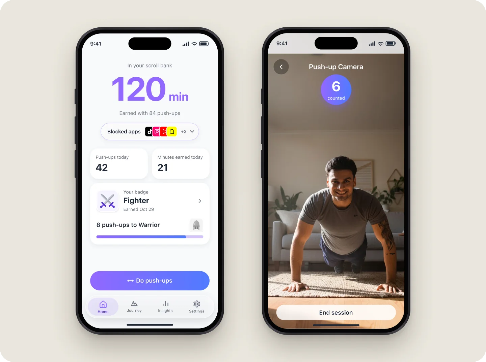

Some iPhone app blockers are free. Some are free for one app or a few rules, and some only work with a subscription. This article goes through 15 of them as of November 2026, our own app PumpToUnlock among them, and through Screen Time, which Apple builds into the iPhone. For each app it says what you get without paying, how you get back into a blocked app and where it runs. Where another app is the better choice, we say so.

## The short answer

By each maker's own statement on November 15, 2026:

- ScreenZen is free and supported by donations. PushBlock says all its core features are free. Screen Time is part of the iPhone.
- One Sec is free for one app. Opal has a free plan with up to 3 rules. AppBlock has a free version with up to 2 schedules.
- Freedom and BlockSite block apps and websites in their free plans. Scheduling in Freedom and password protection in BlockSite need the paid plan.
- PumpToUnlock is free for blocking apps and opening them with push-ups. Its paid plan, Elite, adds the Journey and Insights.
- Pushscroll, PushUp Time, RepScroll and Unrot need a subscription. Pushscroll starts with a free trial.
- Brick needs its device, which you buy once.
- Clearspace and touch grass are free to download and sell a paid plan.

## How we compared

Every fact about another app comes from that app's own App Store page or from its maker's website, read on November 15, 2026. The sources are linked at the end. We did not install or test the other apps. The article reports what each maker states.

We included only apps with more than 1,000 ratings in the US App Store. We name no prices, for the other apps or for ours, because prices differ by country and change often. The App Store page of each app shows the price that applies to you.

## The apps side by side

| App | How you get back into a blocked app | Without paying | Needs payment | Runs on |
| --- | --- | --- | --- | --- |
| [Opal](https://opalapp.com/) | You take a break. You pick the app, write down your intention and set a timer. A stricter mode allows no way around the block. | App blocking with up to 3 rules, schedules, time limits and open limits | Opal Pro, for unlimited rules, the mode that cannot be turned off and the history of your score | iPhone, Android, Mac |
| [ScreenZen](https://screenzen.co/) | You wait through a delay that can grow with each opening, or the app stays blocked for the times you set | The whole app. Its maker says it is completely free and supported by donations. | Nothing. Tips are optional. | iPhone, iPad, Mac, Windows, Android |
| [One Sec](https://one-sec.app/) | You go through a short pause, such as a breathing exercise, and then decide | One app of your choice | one sec pro, for more apps and more settings | iPhone, iPad, Android, Mac, browser extensions |
| [Clearspace](https://www.getclearspace.com/) | A short pause. Then you close the app, or you earn more time with push-ups or a breathing exercise. | The download. Its site does not say where the free part ends. | Clearspace Premium | iPhone, Android |
| [AppBlock](https://appblock.app/) | The block holds for the time or condition you set. Strict Mode keeps you from getting around it. | A free version with limits, among them 2 schedules and a Quick Block of at most 4 hours | AppBlock Premium, which removes the limits | iPhone, iPad, Android, browser extensions |
| [Freedom](https://freedom.to/) | The app stays blocked until the session ends. Locked Mode prevents quitting a session. | Blocking sessions, your own blocklists and syncing across devices | Freedom Premium, for scheduling, sessions of 2 hours and more, and Locked Mode | iPhone, iPad, Android, Mac, Windows, Chromebook |
| [BlockSite](https://blocksite.co/) | The block holds while it is switched on or scheduled | Blocking websites and apps, by its own description | BlockSite Premium, for blocking by keyword, unlimited category blocking and password protection | iPhone. Its site says it syncs with your other devices. |
| [Brick](https://getbrick.com/) | You tap your phone on the Brick, a small device that you keep somewhere else | The app | The device, a one-time purchase without recurring fees | iPhone, Android |
| [Pushscroll](https://pushscroll.com/) | Exercise counted by the camera, or steps | A free trial | A subscription for the whole app | iPhone, iPad, Android |
| [PushUp Time](https://pushuptimeapp.com/) | A set of push-ups, squats, sit-ups, lunges or jumping jacks | The download | A subscription, which the app requires | iPhone |
| [RepScroll](https://repscroll.com/) | A set of push-ups or squats, or a plank | The download | A subscription for full access | iPhone, iPad |
| [PushBlock](https://apps.apple.com/us/app/pushup-app-blocker-pushblock/id6756033795) | Push-ups counted by the camera | All core features, by its own description | Nothing listed | iPhone |
| [Unrot](https://www.unrot.com/) | Coins that you earn by finishing habits | The download | A subscription, which the app requires | iPhone |
| [touch grass](https://touchgrass.now/) | A photo of real grass | Blocking and unlocking with a photo | Premium, for unlimited apps and categories and for screen time history | iPhone |
| [PumpToUnlock](/) | Push-ups counted by the camera | Blocking apps, push-ups, Intensity and the scroll bank | Elite, which adds the Journey and Insights | iPhone |

## What the iPhone does by itself

Screen Time is part of the iPhone and costs nothing. Apple describes two tools in it. Time Allowances set how long you can use the apps of a category, such as social media or games, each day. Schedules set when during the day you can use them. Both need iOS 27 or later. Screen Time also shows how much time you spend in each app and how often you pick up your iPhone, and it shares its settings with your iPad and Mac. Apple's guide does not say what you see when an allowance is used up, and we did not test it. Several apps in this article, ours among them, are built on Screen Time. It fits you if you want to start without installing anything. Sources: [Apple's guide to setting up Screen Time](https://support.apple.com/guide/iphone/set-up-screen-time-for-yourself-iphbfa595995/ios), [Apple's guide to Schedules and Time Allowances](https://support.apple.com/guide/iphone/set-schedules-with-screen-time-iphb0c7313c9/ios).

## Apps that block or make you wait

**Opal** blocks apps and websites at set times, by daily time limit or by number of openings. To get into a blocked app you take a break, which means you pick the app, write down your intention and set a timer. A stricter mode allows no way around the block. The free plan includes app blocking with up to 3 rules. Opal Pro removes that limit and adds the mode that cannot be turned off and the history of your focus score. Opal runs on iPhone, Android and Mac, so it fits you if you want the same rules on your phone and on your computer. Sources: [Opal on the App Store](https://apps.apple.com/us/app/opal-screen-time-control/id1497465230), [Opal's pricing page](https://opalapp.com/pricing).

**ScreenZen** puts a delay in front of the apps you choose, and the delay can grow each time you open the app. It can also cut a session short, limit how often you open an app in a day and block apps fully at set times. Its maker states that the app is completely free and supported by donations, and the in-app purchases on its App Store page are tips. It runs on iPhone, iPad, Mac, Windows and Android. If you want a blocker that costs nothing on every device you own, look at this one first. Sources: [ScreenZen on the App Store](https://apps.apple.com/us/app/screenzen-screen-time-control/id1541027222), [ScreenZen's website](https://screenzen.co/).

**One Sec** is built around a pause. Every time you open a chosen app it shows a short exercise, such as a deep breath, and then lets you decide. After a set time in the app it can interrupt you again, and its site says a full block for a session or a schedule is possible too. One app of your choice is free, and its maker says the free version has no ads either. More apps and more settings need one sec pro. One Sec runs on iPhone, iPad, Android and Mac and has extensions for the common browsers. It fits you if a moment to think is enough and a hard lock is more than you need. Sources: [One Sec on the App Store](https://apps.apple.com/us/app/one-sec-screen-time-focus/id1532875441), [One Sec's questions and answers](https://one-sec.app/faq/), [One Sec's platforms page](https://one-sec.app/platforms/).

**Clearspace** sets limits on the apps you choose and shows a short pause when you open one. From there you close the app, or you earn more time with push-ups or a breathing exercise. It also has challenges with friends. The app is free to download and sells Clearspace Premium. On the day we read it, its site did not say where the free part ends. It runs on iPhone and Android. It fits you if you want push-ups as one way among several, together with limits and a challenge with friends. Sources: [Clearspace's website](https://www.getclearspace.com/), [Clearspace on the App Store](https://apps.apple.com/us/app/clearspace-reduce-screen-time/id1572515807).

**AppBlock** blocks apps and websites on a schedule, by place, by Wi-Fi network or by a usage limit, and has a Quick Block for right now. Its Strict Mode is there to keep you from getting around a block. The free version has limits that its maker lists, among them 2 schedules, usage limits of at most 30 minutes and a Quick Block of at most 4 hours. Premium removes them. AppBlock runs on iPhone, iPad and Android and has extensions for Chrome, Edge and Brave. It fits you if you want blocking tied to a place or a Wi-Fi network. Sources: [AppBlock on the App Store](https://apps.apple.com/us/app/appblock-block-apps-websites/id1515753232), [AppBlock's page on its free version](https://appblock.app/is-appblock-free-free-vs-premium-on-iphone/), [AppBlock's table of free and Premium features](https://appblock.app/free-vs-premium-features-appblock-ios/).

**Freedom** blocks apps, websites or the whole internet for the length of a session, on all your devices at once. A blocked app shows a green screen until the session ends. The free plan covers blocking, your own blocklists and syncing a session across devices. Premium adds scheduling, sessions of 2 hours and more, and Locked Mode, which prevents quitting a session. Freedom runs on iPhone, iPad, Android, Mac, Windows and Chromebook. It fits you if your distractions are on your computer as much as on your phone. Sources: [Freedom on the App Store](https://apps.apple.com/us/app/freedom-screen-time-control/id1269788228), [Freedom's plans page](https://freedom.to/premium).

**BlockSite** blocks websites and apps. You put them on a block list, set a schedule or a usage limit, and can block whole categories or every address that contains a keyword. On iPhone it blocks websites in Safari, Chrome and Firefox. Its App Store page says that blocking websites and apps is free. Premium adds blocking by keyword, unlimited category blocking and password protection for your settings. It fits you if websites distract you as much as apps do. Source: [BlockSite on the App Store](https://apps.apple.com/us/app/blocksite-block-apps-focus/id1474967653).

## A device as the key

**Brick** is a small physical device. You tap your iPhone on it to block the apps you chose, and you tap it again to get them back. You can start a block from the app as well, but ending one needs the device, so the key can stay in another room. The app includes five emergency unblocks in case the device is lost. The app is free and the device is a one-time purchase, and its maker states that there are no recurring fees. Brick works with iPhone and Android. It fits you if every way back in on the screen is too easy for you and buying a device is fine. Sources: [Brick on the App Store](https://apps.apple.com/us/app/brick-ditch-distractions/id6448794069), [Brick's questions and answers](https://getbrick.com/pages/faq), [Brick's product page](https://getbrick.com/products/grey-brick).

## Apps that make you earn the time

The apps in this group, ours among them, open a blocked app only after you have done something for it.

**Pushscroll** counts exercise with the camera and gives minutes for it. It recognises push-ups, squats, planks, sit-ups and lunges, counts your steps through Apple Health, and has guided workouts, a journey with levels and duels against friends. It also runs on Android. After a free trial, a subscription is needed for the whole app. It fits you if you want many kinds of exercise in one app. Sources: [Pushscroll's website](https://pushscroll.com/), [Pushscroll's pricing page](https://pushscroll.com/pricing), [Pushscroll on the App Store](https://apps.apple.com/us/app/pushscroll-exercise-to-scroll/id6741765734).

**PushUp Time** blocks the apps you choose until you finish a set of push-ups, squats, sit-ups, lunges or jumping jacks. You set how many repetitions a break costs and how long the break lasts, from 15 minutes to 2 hours or a length of your own. It can give apps a daily allowance before repetitions are needed, and it can block on a schedule. Its maker states that detection runs on the iPhone and that camera video is never uploaded. The app requires a subscription. It fits you if you want exercise combined with schedules and daily allowances. Sources: [PushUp Time on the App Store](https://apps.apple.com/us/app/pushup-time-app-blocker/id6749405784), [PushUp Time's website](https://pushuptimeapp.com/).

**RepScroll** locks the apps you choose and opens them for a set time after a set of push-ups or squats or a plank, counted by the camera. It has a strict mode that prevents removing the app until the repetitions are done, and it writes workouts to Apple Health. Full access needs a subscription. The app is available in 37 languages. Sources: [RepScroll on the App Store](https://apps.apple.com/us/app/repscroll-screen-time-blocker/id6755953205), [RepScroll's website](https://repscroll.com/).

**PushBlock** locks apps until you have done push-ups in front of the camera. You can set a push-up goal for each app, and it shows your daily and weekly counts. Its App Store page says that all core features are free, without subscriptions and without ads, and it lists no in-app purchases. The app is in English. Source: [PushBlock on the App Store](https://apps.apple.com/us/app/pushup-app-blocker-pushblock/id6756033795).

Two more apps ask for something other than exercise.

**Unrot** gives coins for habits you finish, such as reading or a walk, confirmed with a timer or a photo. The coins open your apps for a limited time. Using Unrot requires a subscription. Sources: [Unrot's website](https://www.unrot.com/), [Unrot's pricing page](https://www.unrot.com/pricing).

**touch grass** opens your apps after you take a photo of real grass. Its Premium plan adds unlimited apps and categories and a screen time history. Source: [touch grass on the App Store](https://apps.apple.com/us/app/touch-grass-screen-time-limit/id6739589530).

**PumpToUnlock** is our app. It locks the apps you choose until you do push-ups in front of the camera. It knows one exercise, the push-up. It runs on iPhone and is available in English, German and Japanese.

## What is free in PumpToUnlock

These parts of PumpToUnlock work without payment.

- **Blocking apps.** You pick the apps and categories in Apple's own picker. The app sets no limit of its own on how many.
- **Push-ups counted by the camera.** You can do as many sessions as you like.
- **Intensity.** This is the setting for how many push-ups a minute costs.
- **The scroll bank.** Earned minutes wait there until you spend them.
- **Today's numbers.** The Home screen shows your push-ups and earned minutes of the day.

The app has no account and no ads.

The paid plan is called Elite and comes as a monthly, yearly or one-time purchase. It adds the Journey and Insights. The Journey has 12 badges for 10 to 1,000 push-ups in one day, and each badge can be shared as a picture. Insights shows your screen time by day, week and month, your push-up and minute statistics and the apps that tempt you most. Elite also includes a daily reminder. At the end of setup the app shows the Elite plans. You can close that screen, and everything in the list above keeps working.

Among the apps above that open with push-ups, Pushscroll, PushUp Time and RepScroll state in their own App Store texts that a subscription is needed, and Clearspace sells a Premium plan. PushBlock and PumpToUnlock give you the push-up lock without payment.

## Why the main part is free

We made this part free to help people build discipline and get rid of doomscrolling without paying a cent. We believe in giving back to the community.

The app shows no ads and does not sell data. Elite is the only thing it earns money with.

## How the camera counts a push-up

You place the iPhone on the floor in front of you with the front camera facing you. After a countdown of 5 seconds the app analyses up to 10 camera pictures a second. In each picture, pose detection software on the iPhone finds your shoulders, elbows, wrists and hips. From shoulder, elbow and wrist the app works out the angle of each elbow.

A push-up starts with straight arms. It counts as down when the elbow angle falls below 110 degrees, and as finished when the angle is above 150 degrees again. The lower line sits at 110 degrees, which is more forgiving than a strict 90. Seen from the floor, your arm points towards the lens at the bottom of a push-up, so it looks less bent in the picture than it is.

The elbow angle alone would also count someone who stands in front of the phone and bends their arms. So each repetition has to pass more checks. Your shoulders must travel down towards your hands and back up by at least a fifth of your shoulder width. Your hands must stay where they are. Your body must not be upright. A repetition that fails one of these checks is not counted. A picture is left out when the app cannot see both arms clearly, when your shoulders are tilted or when you are too far from the camera. When a repetition takes less than half a second, the app asks you to slow down.

<figure>
  <picture>
    <source media="(max-width: 899px)" type="image/avif" srcset="/img/blog/pumptounlock-scroll-bank-and-push-up-camera-phone-700.avif 700w, /img/blog/pumptounlock-scroll-bank-and-push-up-camera-phone-1050.avif 1050w" sizes="calc(100vw - 40px)" />
    <source media="(max-width: 899px)" srcset="/img/blog/pumptounlock-scroll-bank-and-push-up-camera-phone-700.webp 700w, /img/blog/pumptounlock-scroll-bank-and-push-up-camera-phone-1050.webp 1050w" sizes="calc(100vw - 40px)" />
    <source type="image/avif" srcset="/img/blog/pumptounlock-scroll-bank-and-push-up-camera-720.avif 720w, /img/blog/pumptounlock-scroll-bank-and-push-up-camera-1440.avif 1440w" sizes="720px" />
    
  </picture>
  <figcaption>Left, the scroll bank on Home. Right, the camera counting a push-up.</figcaption>
</figure>

## What stays on the iPhone

The camera picture is analysed on the iPhone and is never uploaded. The app records no video and no sound. The first time you reach a badge, it keeps one still picture for the badge picture you can share. That picture stays in the app's storage on your iPhone and leaves it only when you share it yourself.

Some data does leave the phone, and our [Privacy Policy](/privacy/) lists all of it. The app sends the push-ups and earned minutes of each session, your Intensity, the balance of your scroll bank, usage data and purchase records. All of it is stored under a random ID, never under your name, because the app never asks for a name or an email address. Blocking apps, counting push-ups and earning and spending minutes work without an internet connection.

## How Intensity works

Intensity is the price of a minute. It is made of two numbers, the push-ups you do and the minutes they earn. Setup offers Chill with 1 push-up for 1 minute, Balanced with 2 push-ups for 1 minute and Hardcore with 5 push-ups for 1 minute. Later you can set both numbers freely.

The app divides your push-ups by the first number, drops the remainder and multiplies the result by the second number. With an Intensity of 5 push-ups for 2 minutes, 23 push-ups earn 8 minutes.

Earned minutes go into the scroll bank and wait there. When you open a blocked app, its lock screen has a button called Use minutes, and you choose how many minutes to spend on that app. The app locks again after that much use, and minutes you did not use go back to the bank at midnight. So you can do your push-ups in the morning and scroll in the evening.

## Which one fits you

- You want to start without installing anything. Try Screen Time first.
- Nothing may cost anything, and you want a blocker on every device. Start with ScreenZen.
- One app is your problem, and a pause is enough. One Sec covers that app for free.
- You want schedules and limits on your phone and on your computer. Look at Opal.
- Your distractions are on your computer as much as on your phone. Look at Freedom.
- You want blocking tied to a place or a Wi-Fi network. Look at AppBlock.
- Websites distract you as much as apps do. Look at BlockSite.
- Every way back in on the screen is too easy for you. Brick puts the key in another room.
- You want to earn your time with many kinds of exercise, or you use Android. Look at Pushscroll.
- You want exercise together with schedules and daily allowances. Look at PushUp Time.
- You want push-ups in front of your apps without paying for the lock. PushBlock and PumpToUnlock both do that. PushBlock lets you set a push-up goal for each app. In PumpToUnlock the minutes you earn in the morning wait in the scroll bank until the evening, and the app is available in English, German and Japanese.

## Sources

All pages were read on November 15, 2026. Features, plans and prices can change after that date.

- Screen Time: [Apple's guide to setting up Screen Time](https://support.apple.com/guide/iphone/set-up-screen-time-for-yourself-iphbfa595995/ios), [Apple's guide to Schedules and Time Allowances](https://support.apple.com/guide/iphone/set-schedules-with-screen-time-iphb0c7313c9/ios)
- Opal: [Opal on the App Store](https://apps.apple.com/us/app/opal-screen-time-control/id1497465230), [Opal's pricing page](https://opalapp.com/pricing)
- ScreenZen: [ScreenZen on the App Store](https://apps.apple.com/us/app/screenzen-screen-time-control/id1541027222), [ScreenZen's website](https://screenzen.co/)
- One Sec: [One Sec on the App Store](https://apps.apple.com/us/app/one-sec-screen-time-focus/id1532875441), [One Sec's questions and answers](https://one-sec.app/faq/), [One Sec's platforms page](https://one-sec.app/platforms/)
- Clearspace: [Clearspace on the App Store](https://apps.apple.com/us/app/clearspace-reduce-screen-time/id1572515807), [Clearspace's website](https://www.getclearspace.com/)
- AppBlock: [AppBlock on the App Store](https://apps.apple.com/us/app/appblock-block-apps-websites/id1515753232), [AppBlock's page on its free version](https://appblock.app/is-appblock-free-free-vs-premium-on-iphone/), [AppBlock's table of free and Premium features](https://appblock.app/free-vs-premium-features-appblock-ios/)
- Freedom: [Freedom on the App Store](https://apps.apple.com/us/app/freedom-screen-time-control/id1269788228), [Freedom's plans page](https://freedom.to/premium)
- BlockSite: [BlockSite on the App Store](https://apps.apple.com/us/app/blocksite-block-apps-focus/id1474967653)
- Brick: [Brick on the App Store](https://apps.apple.com/us/app/brick-ditch-distractions/id6448794069), [Brick's questions and answers](https://getbrick.com/pages/faq), [Brick's product page](https://getbrick.com/products/grey-brick)
- Pushscroll: [Pushscroll on the App Store](https://apps.apple.com/us/app/pushscroll-exercise-to-scroll/id6741765734), [Pushscroll's website](https://pushscroll.com/), [Pushscroll's pricing page](https://pushscroll.com/pricing)
- PushUp Time: [PushUp Time on the App Store](https://apps.apple.com/us/app/pushup-time-app-blocker/id6749405784), [PushUp Time's website](https://pushuptimeapp.com/)
- RepScroll: [RepScroll on the App Store](https://apps.apple.com/us/app/repscroll-screen-time-blocker/id6755953205), [RepScroll's website](https://repscroll.com/)
- PushBlock: [PushBlock on the App Store](https://apps.apple.com/us/app/pushup-app-blocker-pushblock/id6756033795)
- Unrot: [Unrot on the App Store](https://apps.apple.com/us/app/unrot-earn-your-screen-time/id6746537171), [Unrot's website](https://www.unrot.com/), [Unrot's pricing page](https://www.unrot.com/pricing)
- touch grass: [touch grass on the App Store](https://apps.apple.com/us/app/touch-grass-screen-time-limit/id6739589530)
- PumpToUnlock: [PumpToUnlock on the App Store](https://apps.apple.com/app/id6802252587), [Privacy Policy](/privacy/)
