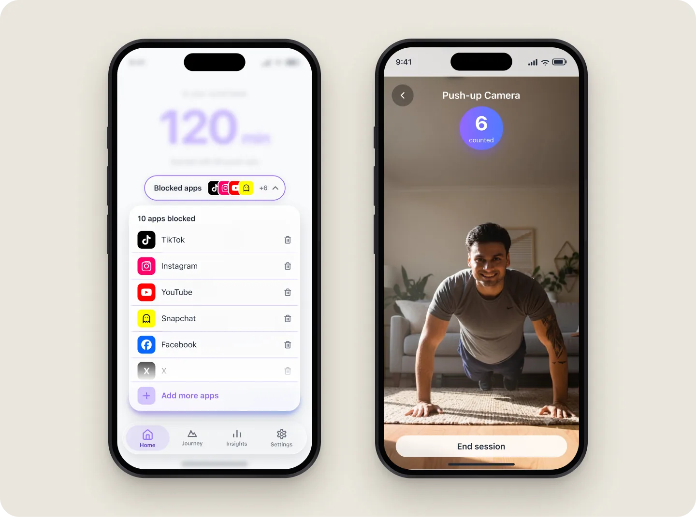

Instagram stays locked until you do push-ups. This is how to set that up in PumpToUnlock, and what you see when you open Instagram afterwards.

## What you need

An iPhone with iOS 16 or later and the PumpToUnlock app. You need no account.

## Set it up

1. **Block Instagram**
   Open PumpToUnlock and choose Instagram from Apple’s Screen Time list. You can add other apps and whole categories too.
2. **Set the Intensity**
   The Intensity is how many push-ups a minute costs. You set it yourself.
3. **Do your first push-ups**
   Put the iPhone on the floor in front of you, with the front camera facing you. The camera counts every rep, and the minutes go into your scroll bank.

<figure>
  <picture>
    <source media="(max-width: 899px)" type="image/avif" srcset="/img/article-two-phones-mobile-700.avif 700w, /img/article-two-phones-mobile-1050.avif 1050w" sizes="calc(100vw - 40px)" />
    <source media="(max-width: 899px)" srcset="/img/article-two-phones-mobile-700.webp 700w, /img/article-two-phones-mobile-1050.webp 1050w" sizes="calc(100vw - 40px)" />
    <source type="image/avif" srcset="/img/article-two-phones-720.avif 720w, /img/article-two-phones-1440.avif 1440w" sizes="720px" />
    
  </picture>
  <figcaption>Left, the blocked apps. Right, the camera counting push-ups.</figcaption>
</figure>

## When you open Instagram

Instagram shows the PumpToUnlock lock screen. It tells you how many push-ups earn the next minutes. Do them, and Instagram opens until the minutes are used up.
